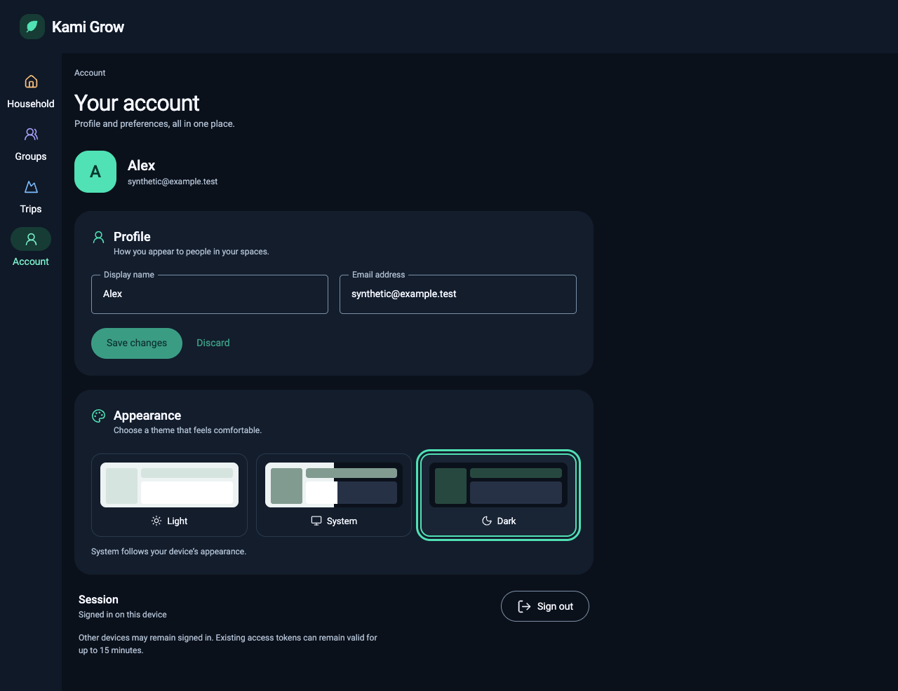
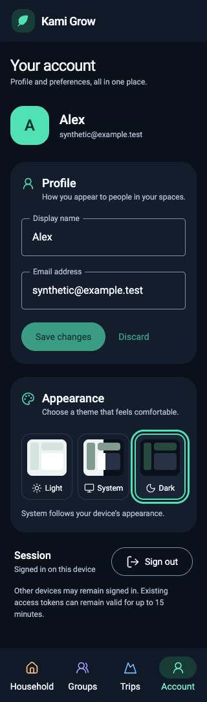
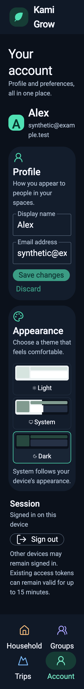

# Immediate appearance persistence (#236)

Independent requirements testing on 2026-10-11 (America/Los_Angeles) exercised
production code at `e50ed2763a0733e9a5af1b07d7980170fd5a327c`. Enlarged-text runs
record `8a693290`, whose production code is identical (the later commit adds one
regression test). The subsequent evidence/harness commit does not change runtime
behavior.

## Browser acceptance

The production preview ran at localhost:3196 with synthetic Auth/GraphQL fixtures
using `scripts/appearance-browser.cjs`, external Playwright, and Chrome
155.0.8059.39. Run separately with `WIDTH=1280`, `390`, and `320`, then repeat
with `TEXT_ONLY=1` for Account at 200% root font size. Supply `PORT`,
`PLAYWRIGHT_MODULE`, `CHROME_PATH`, `OUTPUT_DIR`, and `TESTED_COMMIT` as described
in the [earlier appearance evidence](appearance-browser-evidence.md).

All three widths passed immediate Light/System/Dark application without Save,
background persistence, rapid Space/ArrowLeft radio selection during saving,
retained keyboard focus and latest-choice persistence. System follows live device
appearance changes; explicit themes ignore them. Confirmed choices survive
reload, cache-free server restoration and navigation. All runs report no browser
JavaScript errors or document horizontal overflow. Exact approved #227 tokens
and Light/Dark contrast checks pass. Account 200% text passes all three widths;
independent screenshot inspection confirms readable Appearance content.

Machine-readable results: [desktop](evidence/appearance-236/appearance-1280.json),
[390px](evidence/appearance-236/appearance-390.json),
[320px](evidence/appearance-236/appearance-320.json), and enlarged text at
[desktop](evidence/appearance-236/text200-1280.json),
[390px](evidence/appearance-236/text200-390.json),
[320px](evidence/appearance-236/text200-320.json).

## Recovery and limitations

All 358 component/unit tests passed. Editor/provider tests cover delayed rapid
choices, returning to the original choice, stale responses, concurrent conflict
on a queued follow-up, failed/ambiguous writes, committed response loss, failed
recovery reads, retained intent, mismatched confirmation, initial-read retry,
account replacement and access-boundary unmount. Uncertain/conflicting writes
require a reread and explicit recovery; no automatic conflict overwrite occurs.

Browser fixtures establish frontend interaction and layout, not hosted Auth,
physical devices or assistive-technology behavior. Durable account persistence
and server authorization continue to use the unchanged guarded API contract and
its existing integration tests. No new server/schema behavior is introduced.

The runner now clicks visible radio labels without forced interaction and uses
the existing exact #227 palette constants; these replace stale harness assumptions
without changing production controls, tokens or contrast thresholds. Dated
#220/#223/#227 records remain historical evidence.
