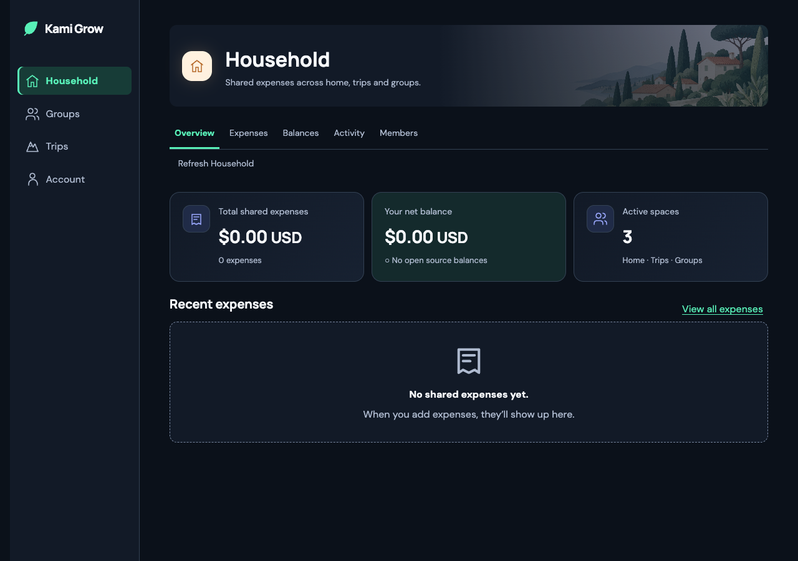
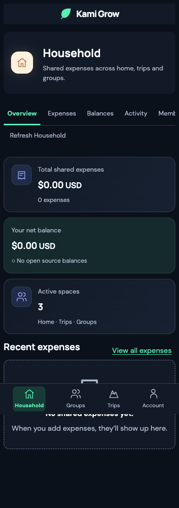
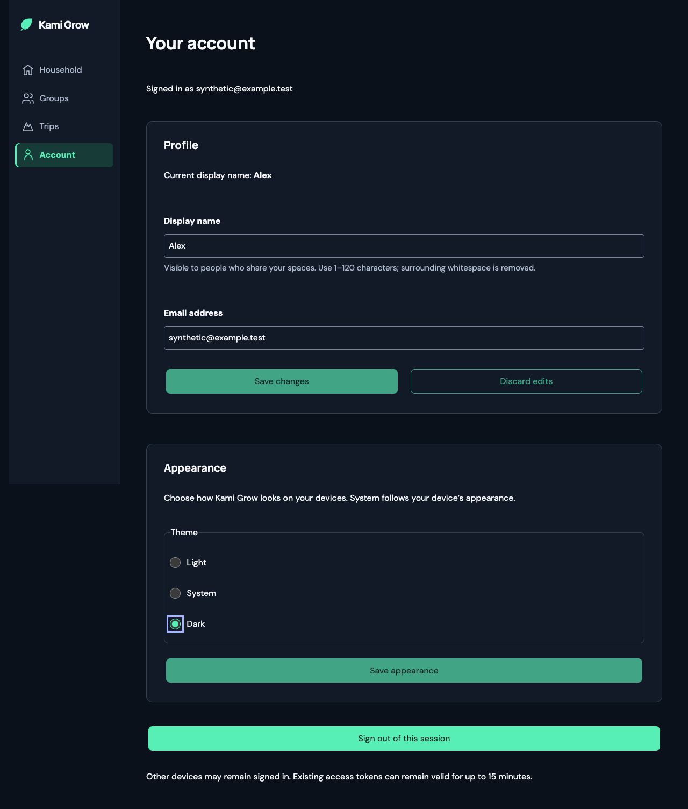
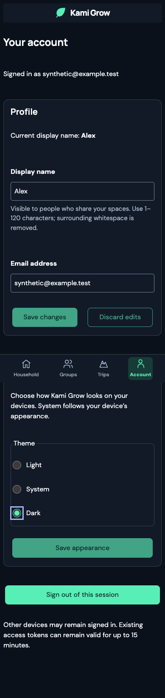

# Appearance browser evidence (#220)

Independent requirements testing on 2026-10-06 (America/Los_Angeles).
Full browser flows tested commit `ddee97c`; bounded 200% root-text checks and
focused unit tests also tested `aa44863` (production code last changed in
`595bb21`). The subsequent evidence-only commit adds this record and artifacts.

## Reproduction and scope

Run a production web preview on localhost port 3193, then execute
`scripts/appearance-browser.cjs` with `PORT=3193`, `WIDTH=1280`, `WIDTH=390`, and
`WIDTH=320` in separate runs. Supply `PLAYWRIGHT_MODULE` and `CHROME_PATH` when
Playwright and Chrome are external to the repository, plus `OUTPUT_DIR` and
`TESTED_COMMIT`. Add `TEXT_ONLY=1` for the bounded Household 200% root-font check
at each width. The runner intercepts authentication and GraphQL with synthetic
fixtures; it never calls hosted account services or modifies real financial data.

## Verified requirements

- Default Light on a dark operating-system preference; Account exposes exactly
  Light, System, Dark. Changes save without signing out. Explicit choices ignore
  OS changes; System follows live light/dark changes.
- A cached Dark preference is present at the first animation frame after reload.
  Reloading with the appearance cache removed obtains the saved server fixture
  preference. Navigation retains Dark across Household, Trips, Groups, balances,
  expenses, activity, members, invitations, and Account.
- All 13 normative dark tokens resolve exactly to the issue's canonical values.
  Eight foreground/background pairs satisfy WCAG contrast thresholds: primary
  and muted text, actions, danger and owes states (4.5:1), control borders and
  focus against the surface (3:1), in Light and Dark.
- Household removes repayment-exclusion copy and the open-balances link, retains
  the Balances tab, and renders large integer-minor-unit amounts without losing
  precision. Empty Household and Account loading/error states retain Dark.
- Keyboard radio focus and filter-dialog Enter/Escape/focus restoration work.
  Radio controls have intrinsic width at most 24px and a label target at least
  44px tall, correcting the initial screenshot finding where inherited input
  styles separated the radio from its label.
- Desktop 1280px and mobile 390px/320px pages have no horizontal overflow in the
  representative routes, including a separate 200% root-font Household check
  at all three widths. Browser JavaScript errors: none.

The independently added editor tests cover confirmed saves, duplicate suppression,
compare-and-set payloads, conflict and transport-failure reconciliation, initial
read retry, and ignoring a late save after an account switch. Together with the
provider tests, the focused Vitest run passes 9 tests. Focused ESLint and Prettier
checks pass. The delivery coordinator records full repository and backend checks
separately on the PR.

## Representative captures

Machine-readable run results are in [desktop](evidence/appearance-220/appearance-1280.json),
[390px mobile](evidence/appearance-220/appearance-390.json), and
[320px mobile](evidence/appearance-220/appearance-320.json).

Full-page mobile captures composite the fixed navigation bar at the original
900px viewport boundary; scrolling moves content past it.

Bounded text-scaling results are recorded in `text200-1280.json`,
`text200-390.json`, and `text200-320.json` beside the full-run results.

## Limits

These browser fixtures prove frontend behavior and rendering, not real-device
cross-session persistence or server authorization. Backend profile, migration,
and concurrency tests provide separate evidence for those boundaries. Contrast
checks cover shared token pairs, not every rasterized pixel or artwork gradient.
Browser evidence uses Chromium with reduced motion; other browser engines,
physical devices and screen readers were not exercised here. Root-font scaling
was tested at 200%; browser chrome zoom was not tested.
