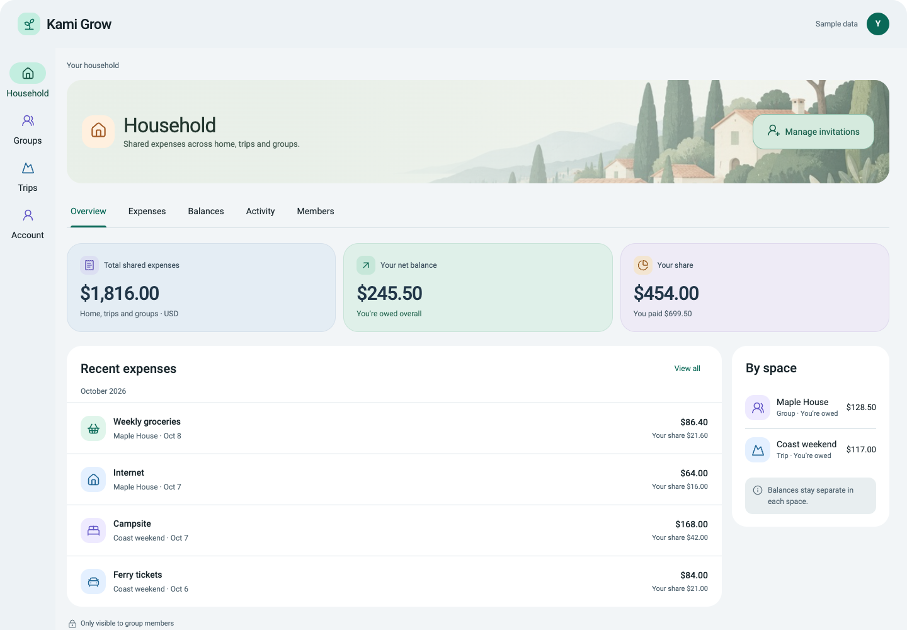
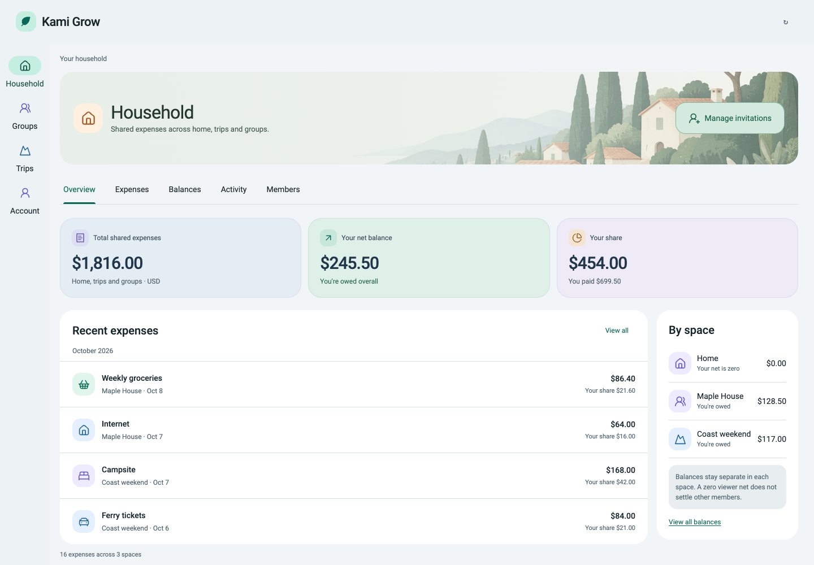
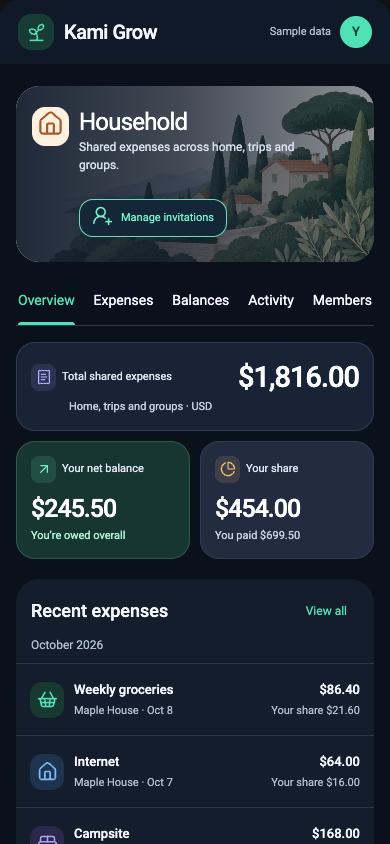
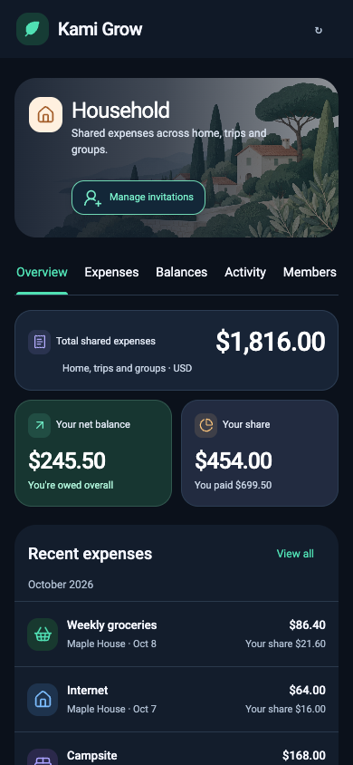
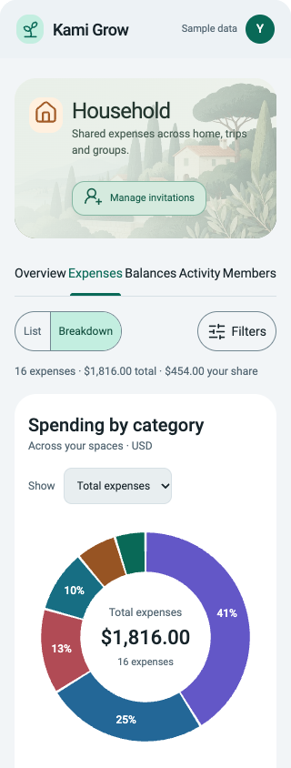
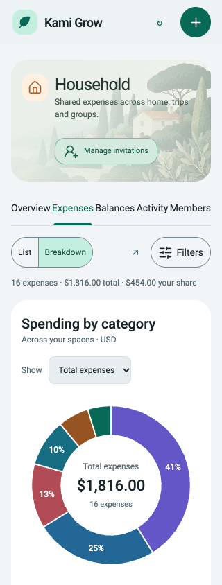
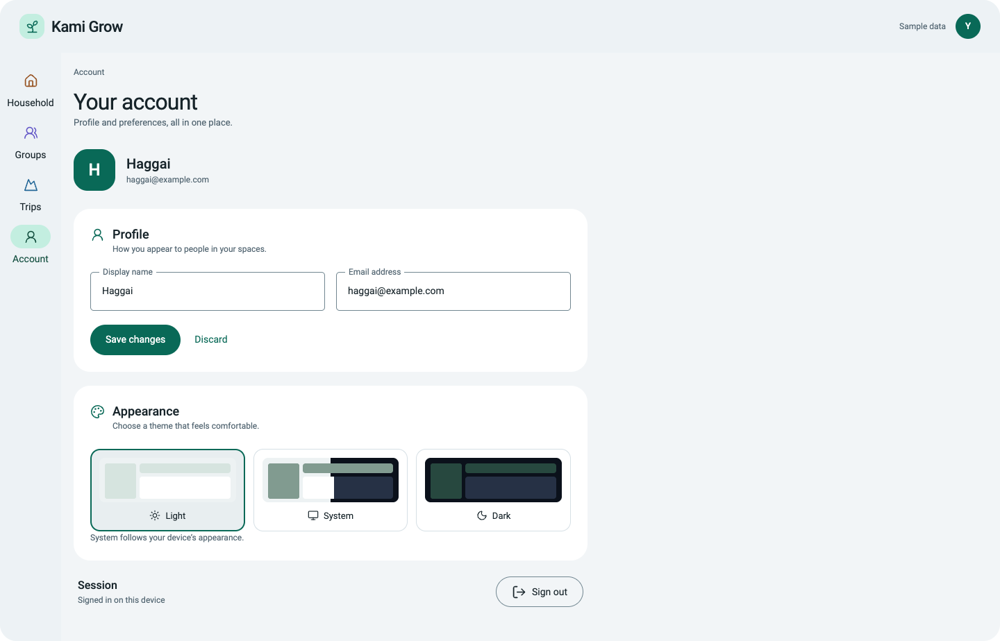
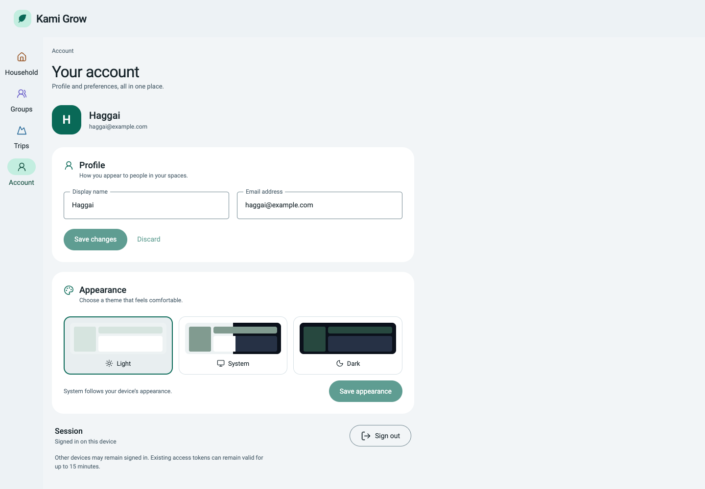

# Issue #227 comparison evidence

This is the synthetic evidence index for [issue #227](https://github.com/haggaikaunda/kami-split/issues/227) and [PR #228](https://github.com/haggaikaunda/kami-split/pull/228). The [46-row parity matrix](../../issue-227-parity-matrix.md) maps routes, interactions and recovery contracts to the evidence below. [Discrepancies](discrepancies.md) records the findings and their owning corrections.

**Independent requirements and visual verdict: PASS, all 46 rows verified; no unresolved issue-specific visual finding.** The frozen application candidate is commit `37f4f3dc5fbf07b0d61c81330a6c651b26d32f54`, Next production build `oQjqwVCa1XwhfqDd4WnhN`. Final visual/client datasets and the full comparison inspection are complete. Earlier real-service and proxy datasets retain their actual identities below; they are not relabeled as final-build captures. Publication commits add documentation/evidence and exclude those artifacts from deployment uploads; application source is unchanged. Exact publication-head CI, tester attestation, whole-final-diff review and post-merge closeout are recorded on PR #228.

## Reference comparison

The authority is commit `3824ce6a878e00d6e417bff8b0e1f7d1988f33e7` and its [reference ZIP](https://github.com/haggaikaunda/kami-split/raw/3824ce6a878e00d6e417bff8b0e1f7d1988f33e7/docs/design/references/material3/kami-grow-material-design-reference-2026-10-09.zip), SHA-256 `26d02893c8bb6333076a772570c8775f9472d99fa95bf1f64ebf69963d0dad62`. The pre-implementation inventory records interactive export inspection; Household Overview was inspected at desktop/phone in both themes before migration of the other surfaces.

Original source fragments were rendered at identical inner application dimensions, excluding the export wrapper and preserving its original `<!doctype html>` standards mode. Every final reference records/asserts `CSS1Compat` and the HTML doctype. The earlier wrapper accidentally invoked quirks mode; its comparisons were replaced, rather than copying browser-default quirks margins into the application. Local Roboto and the exact Lucide 1.17 dependency supply fonts/icons; reference visual styles were not rewritten. Capture JSON records actual bounds, computed styles, resolved theme and loaded font. There are 250 reference states: 25 supported surfaces × five viewport widths × Light/Dark. Four additional selected/share/five-filter states at 1440/390 in both themes supply 16 matched comparisons. Additional [form-flow](archives/reference-form-flow.zip), [avatar-role](archives/reference-avatar-roles.zip) and [participant-layout](archives/reference-participant-flow.zip) reference measurements preserve the original standards-mode source for the final owning-component checks.

| Viewport                | Original reference                           | Final application                                                                    | Matched overlay / difference                   |
| ----------------------- | -------------------------------------------- | ------------------------------------------------------------------------------------ | ---------------------------------------------- |
| 1440px                  | [Reference](archives/reference-1440.zip)     | [Application](archives/application-1440.zip)                                         | [Comparison](archives/comparison-1440.zip)     |
| 1280px                  | [Reference](archives/reference-1280.zip)     | [Application](archives/application-1280.zip)                                         | [Comparison](archives/comparison-1280.zip)     |
| 768px                   | [Reference](archives/reference-768.zip)      | [Application](archives/application-768.zip)                                          | [Comparison](archives/comparison-768.zip)      |
| 390px                   | [Reference](archives/reference-390.zip)      | [Application](archives/application-390.zip)                                          | [Comparison](archives/comparison-390.zip)      |
| 320px                   | [Reference](archives/reference-320.zip)      | [Application](archives/application-320.zip)                                          | [Comparison](archives/comparison-320.zip)      |
| Selected / five filters | [Reference](archives/reference-selected.zip) | [Application](archives/selected.zip), [native drafts](archives/populated-filter.zip) | [Comparison](archives/comparison-selected.zip) |

Archives contain full/viewport images, original computed-style JSON where captured, raw results/provenance and an image manifest. PNG screenshots were converted to lossless WebP; every decoded RGBA payload and both dimensions were verified identical. The manifests record original PNG, encoded WebP and decoded-pixel SHA-256 values. `sourceName` maps original JSON filenames to the archive images. Files beyond WebP dimension limits retain PNG. [Archive checksums](archives.json) verify every downloadable bundle. Width archives partition images while shared results/manifests describe the complete dataset. Download/extract the corresponding width archive to inspect its images and original JSON. No screenshot was resized or retouched.

Comparisons align at the top left without scaling and record the shared rectangle and any excluded extent. Pixel differences are descriptive, not a pass threshold. Independent inspection also covers full-page and internal-dialog content beyond the compared rectangle. Reference sample handlers/data are not production policy; real capabilities use the approved component roles and retain their full behavior.

## Normal matrix

The final normal matrix contains 290 capture/check cases: 29 application surfaces × 1440/1280/768/390/320 × Light/Dark. All have loaded local Roboto, no accidental document overflow, and no page/runtime diagnostic failure. Each viewport archive above contains original per-state metrics and full/viewport captures; fixed dialogs additionally include their internal scrolling evidence. The original reference represents 25 of these surfaces; production loading/error/discovery states use approved shared roles and are independently inspected.

Representative viewport pairs are available directly below; the archives contain the complete inventory.

| Surface                 | Reference                                                                            | Application                                                                              |
| ----------------------- | ------------------------------------------------------------------------------------ | ---------------------------------------------------------------------------------------- |
| Desktop Overview, Light |  |  |
| Phone Overview, Dark    |      |      |
| Phone Breakdown, Light  |   |   |
| Desktop Account, Light  |              |              |

## Extended and enlarged text

The final visual/client datasets verify `37f4f3d` / `oQjqwVCa1XwhfqDd4WnhN`. The sealed independent report records their passing disposition and the limits of each evidence mode. The avatar, participant-stress and populated-create datasets retain `9605a11` / `u0Hrp0AwQ0VprxRXIGbau`: the final change affects only tablet chart/summary CSS, leaving those controls and styles unchanged. Fresh normal/action cases also cover their visible roles. Older real-service/proxy captures retain their identities in the separate sections below.

- [Tablet breakpoint proof](archives/tablet-breakpoints.zip): 50 cases at 760/761/768/820/821px in both themes, covering all three Overview routes, Breakdown and Account, compared with [30 fresh original-reference cases](archives/reference-breakpoints.zip). Every application case also exercises actual 200% text; chart labels and keyboard selection remain intact.
- [Avatar and participant proof](archives/avatar-roles.zip): 100 role cases across all five widths and both themes, including true 200% checks at the smaller widths; source type, dimensions, colors, centered content, occupied grid tracks and gaps. [Long-name/exact-money stress](archives/participant-stress.zip) covers 16 focused cases without submitting. [Native populated create](archives/populated-create.zip) adds four matched `$16.00` / four `$4.00` preview cases. The `$9,999,999.99` total retains three `$2,500,000.00` shares and one `$2,499,999.99` share, intact and contained.
- [Action-role proof](archives/action-roles.zip): 50 cases with source-measured filled/text/outlined action geometry, row spacing, enabled/disabled/hover/focus behavior and normal/enlarged layouts across widths and themes.
- [Chart explanation and Net disclosure proof](archives/chart-help.zip): 42 cases with exact/rounded/empty/zero/mixed-share states, source panel bounds, relevant external explanatory text, accessible description linkage, keyboard disclosure and popup containment.
- [Final selected-label proof](archives/selected-labels.zip): 30 cases at all five widths in both themes, selected Total/Your share/filtered-share, plus true root200 at 320/390/768. Only selected paths translate 6px and inactive paths dim; labels retain their original polar coordinates and opacity1. Toggle/legend behavior remains intact.

- [Independent computed and actual 200% text matrix](archives/independent.zip): 150 checks over 15 routes, five widths and both themes. Root text doubles from 14 to 28px at 320/390/768; 90 enlarged-text screenshots. Explicit rules and computed metrics distinguish true text resizing from merely shrinking the browser viewport.
- [Extended states](archives/extended.zip): 80 cases for long exact values, no workspaces, creation/repayment, owner/member invitations, sign-in/join, and zero/single/tiny category charts. Large values include actual 200% text at both phone widths. Logged-out pages truthfully default to Light.
- [Final filter/date/disclosure proof](archives/final-filter-proof.zip): 30 cases across all five widths and both themes, with additional 200% checks on small widths. Raw invalid dates, chip/Clear typography, Filter ink, selected-space member labels and keyboard disclosure are asserted. The Net balance disclosure is a 44px toolbar target, keeping the source summary/panel layout intact while preserving its real financial context.
- [Edit at 200% text](archives/edit-text.zip): eight cases at 320/390/768/1440 in both themes, viewport captures and explicit proof that Save changes remains reachable through internal scrolling.
- [Creation-dialog lifecycle](archives/create-dialog.zip): native modal, single heading, containment, keyboard, Escape/backdrop, responsive draft retention and no financial mutation, eight cases at 320/390/768/1440 in both themes.

A zero document-overflow measurement alone does not prove freedom from internal clipping. The independent tester inspected the screenshots and controls and exercised intact long-money keyboard panning. Additional source-unrepresented error/unknown/conflict/recovery branches have component/API coverage as explicitly stated per matrix row; they are not claimed as separate browser screenshots when they were not captured.

## Behavioral interactions

The interaction dataset was regenerated against the frozen application candidate; its raw warning and independent disposition remain visible.

[Raw interaction evidence](archives/interactions.zip) records pagination 6→12→16 with complete totals, five AND filters, draft Reset/Apply/Cancel, category selection/drilldown, history/focus/inertness, resize/draft retention, conflict/unknown recovery, explicit synthetic writes, persisted System/Light/Dark appearance and isolated sign-out. **Raw result: 33/34.** The targeted-join functional assertions pass, while its strict console guard records the pre-existing Supabase multiple-client warning. It remains visible and is independently disposed below; the suite is not reported as 34/34.

The [selected-state archive](archives/selected.zip) and [native populated drafts](archives/populated-filter.zip) cover the final-build share-basis/selected-chart/all-five-filter/populated-dialog states. The 16 matched comparisons use 12 chart/list states plus four native drafts. The raw selected archive also preserves the reopened default dialog observation; its four native-draft replacements are clearly identified in comparison provenance. Those drafts explicitly choose the actual “You · Maple House” option through the browser. The [earlier raw reopen captures](archives/selected-reopen-621faca.zip) retain the fixture ambiguity: synthetic member M0 is reused across spaces, so native defaultValue can select “You · Home.” Production membership IDs are unique UUID primary keys. This is a documented data-fixture limitation; the matched draft is a real UI interaction, not a pixel or application alteration. Synthetic responses establish client behavior only. They do not establish server-side authorization, provider delivery or committed persistence.

## Real services

[Real financial browser log](reports/real-browser-621faca.log) and [screenshots/provenance](archives/real-browser.zip) belong to `621faca` / `Ak9k06g3RBsEurBYAs_9C`. They exercise actual runtime-role PostgreSQL and verified-actor Go GraphQL with an owned disposable Supabase stack: create → edit → reload and immutable expense/edit/repayment Activity in Aggregate, Group, Trip and original Household, plus exact percentage allocation (1001 minor units → 601/400) in Household, Group and Trip. Browser authentication transport is locally supplied; financial persistence is real. Themes, 320/390/768/1280 and actual 100/200% text are included in the historical Activity journey.

[Full expense/Auth/invitation service suite](reports/real-services-2d7d115.log), with [its original provenance](reports/real-services-2d7d115.json), passed 165 top-level tests at `2d7d115` / `GwRHXpWI1C0blHQ2smybT`: `go test -p=1 -race -tags=integration -count=1 -v ./internal/expense/... ./internal/auth/... ./internal/invitation/...`. API/Auth/invitation source did not change afterward. The financial browser journeys were rerun at `621faca`; subsequent changes correct selected SVG path styling, shared action/avatar roles, form/participant spacing, tablet chart/summary breakpoints, toolbar disclosure placement and conditional chart explanations. They preserve the financial/authentication/controller contracts; those presentation changes receive fresh browser and component coverage. The independent tester records that applicability explicitly. This older server-suite log retains its actual identity, not the final build's label.

[Actual Next proxy verification at `621faca`](reports/proxy-621faca.json) passed 13 checks using that exact artifact in a second owned production process and local synthetic upstream: fixed destination/header allowlist, origin/type/action/body-size guards, cache/referrer/session-cookie behavior, redirects, missing configuration and retired route 404s. Owned temporary processes stopped afterward. [Compiled transport verification](reports/compiled-transport.log) records all 27 compiled operations fitting the finite 200 budget (maximum 199) and workspace variants reaching authentication. It is earlier corrective-query evidence; required final CI reruns the authoritative transport tests.

[Owned-stack cleanup](reports/isolated-stack-cleanup.json) confirms its five containers/volumes and private local startup files were removed, while the unrelated existing API container remained running.

All accounts and money were synthetic, all mutations isolated. Publishable reports were scanned for credential/session markers. The owner's live account and private financial data were never used for mutation or screenshot publication.

## Local network

[LAN evidence](archives/lan.zip), at `37f4f3d` / `oQjqwVCa1XwhfqDd4WnhN`, records eight Chrome startups/client navigations over actual `http://192.168.86.22:3229`, four routes × both themes at 390px. Loaded fonts, resolved theme, console/page diagnostics and content widths are recorded. This is a real LAN HTTP request, not a physical-device test or a claim about the deployed production host.

## Repository checks

Sequential checks passed on the final application source/build:

| Command             | Evidence                                                                                                                  |
| ------------------- | ------------------------------------------------------------------------------------------------------------------------- |
| `pnpm format:check` | [Formatting log](reports/repository-format-37f4f3d.log)                                                                   |
| `pnpm lint`         | [Lint log](reports/repository-lint-37f4f3d.log)                                                                           |
| `pnpm typecheck`    | [Type log](reports/repository-types-37f4f3d.log)                                                                          |
| `pnpm test`         | [351 tests / 48 files](reports/repository-tests-37f4f3d.log); [independent rerun](reports/independent-vitest-37f4f3d.log) |
| `pnpm relay:check`  | [27 operations, no drift](reports/repository-relay-37f4f3d.log)                                                           |
| `pnpm build`        | [Production build](reports/repository-build-37f4f3d.log)                                                                  |

Required **Verify** CI must pass on the actual publication head, including repository, web, Go, database integration and container/startup jobs. PR #228 records its exact run and head. Documentation/evidence and reference-tool changes are formatted, linted and link/archive checked separately; the application source/build remains frozen.

Normal/reference/comparison runners and isolated fixtures are committed under `scripts/visual-parity-*.cjs`; their reproduction commands are in the [implementation guide](../../issue-227-implementation.md). [Independent and packaging runner sources](archives/evidence-runners.zip) retain the exact standalone scripts. Adapt their local tool/reference paths; never point fixture runners at production. Original raw JSON is preserved inside archives, unaffected by Markdown formatting.

## Independent verdict

The [requirements/visual report](reports/independent-testing.md) records the tester's independent issue-first assessment, actual dataset identities, all 46 row dispositions and limitations. The [verbatim original](reports/independent-testing-original.txt) preserves the report hash in the [sealed verdict](reports/independent-verdict.json); the Markdown copy receives formatting only. The [whole-diff application review](reports/final-code-review.md) records the separate code-review outcome and all five convention categories. Later publication-head attestation and fresh whole-final-diff review are linked from PR #228. A builder assessment or passing fixture assertion never replaces these gates.

## Limitations

The [discrepancy record](discrepancies.md) also preserves the [earlier selected-label overlays](archives/selected-label-finding-621faca.zip) that exposed the late correction. They used the superseded quirks-mode reference wrapper and remain historical finding evidence only; the final selected comparison uses the original standards mode. They are not final passing comparison images.

- Network fixtures cannot substantiate real authorization, provider delivery, persistence or isolation. Those claims are limited to the recorded real-service suites.
- The tester's computer-use interface rejected local reference exports and lacked supported in-app/Chrome visibility. The tester verified the pinned ZIP, read original source and inspected supplied/source-rendered reference images before comparing the running application with Playwright. This is not described as personally operating the original interactive exports in that interface; the inventory/coordinator records its separate interactive inspection.
- The targeted-join raw console check retains the existing GoTrueClient warning. Its complete proof → password → explicit join behavior passes, relevant production controller/client code is unchanged, temporary clients do not persist sessions, and real Auth/invitation tests pass. The independent tester classifies it as pre-existing nonvisual diagnostic behavior, not a new design/feature regression.
- The existing `GroupSummary.id` / `Group.id` Relay identity collision was independently traced to base `a3530b5`. Truthful fixture IDs are retained; no API/SDL contract changes are made to hide it.
- Rare financial/session/provider recovery branches use preserved component and real-service assertions where the row explicitly says so. Browser screenshots do not imply all those branches were separately replayed.
- Post-merge primary synchronization, branch/worktree cleanup and exact remote-ref absence remain coordinator obligations, recorded separately on the PR/issue after they occur.
