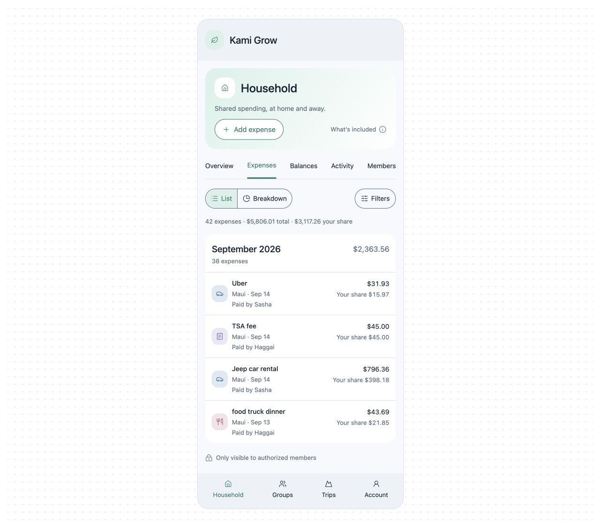
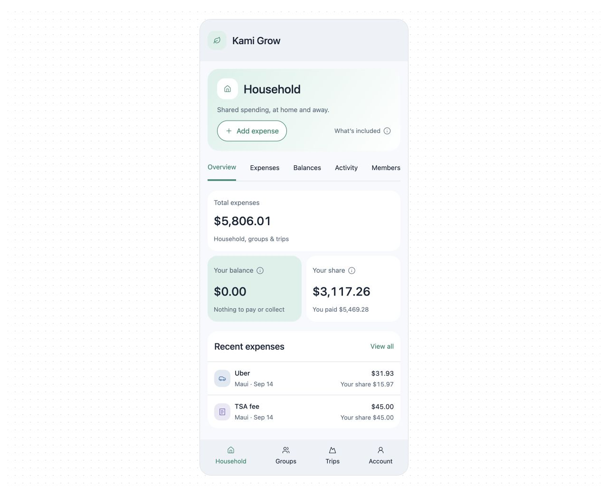
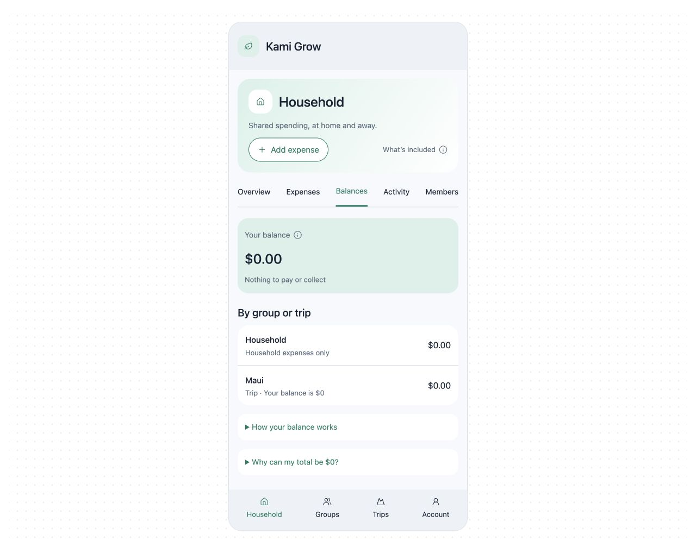
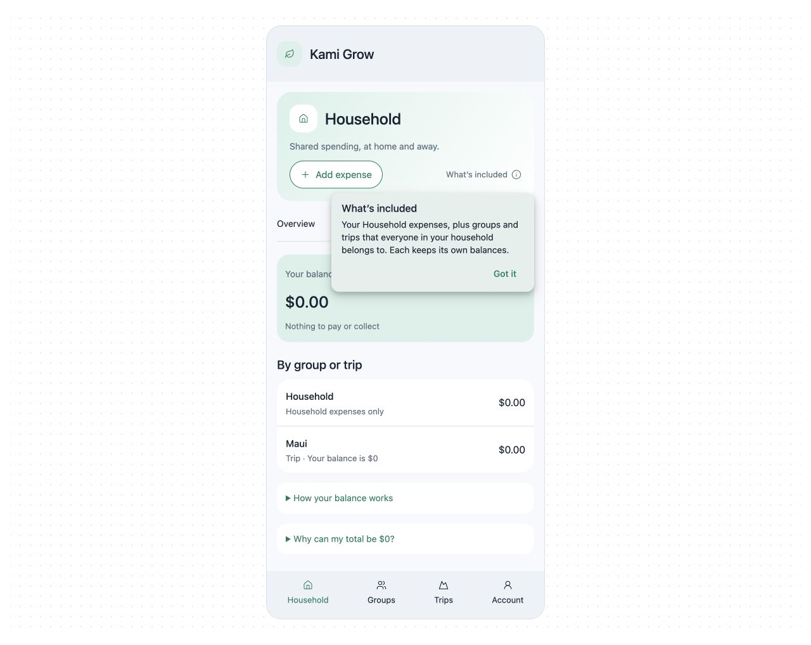

# Approved design reference for issue #269

The owner approved this Household mobile mockup on October 12, 2026, then
explicitly required preserving existing banner background images and leaving
Breakdown's **Spending by category** unchanged. [Issue #269](https://github.com/haggaikaunda/kami-split/issues/269)
is the authoritative acceptance-criteria record. This package archives the actual
approved mockup so future agents do not have to reconstruct it from prose or a
previous chat.

## Open the interactive mockup

Download or clone this directory and open [mockup.html](mockup.html) in a browser.
GitHub displays HTML source rather than executing it. Alternatively, from the
repository root:

```sh
python3 -m http.server 8769 --bind 127.0.0.1 --directory docs/design/issue-269
```

Open `http://127.0.0.1:8769/mockup.html`. No app server, account, credentials,
ChatGPT runtime, or financial API is required. The exported wrapper supplies
fallback local state; allow its pinned CDN resources for icons/runtime styling.
The screenshots remain viewable without those resources.

- Select Expenses, Overview or Balances to inspect the approved surfaces.
- Select **What's included**, **Your balance**, or **Your share** for rich help;
  dismiss with Got it, Escape, or another control.
- On Balances, expand the explanations and worked example.
- The export may remember the last selected tab in browser-local state. Select
  Expenses to reproduce the initial review state.

[mockup.fragment.html](mockup.fragment.html) is the exact original inline source;
[mockup.html](mockup.html) is its standalone export. Both are frozen, byte-preserved
reference artifacts, not application code. `SHA256SUMS` records their integrity
and that of the screenshots. The source's optional host design controls are not
required for the standalone interactions. Do not copy the preview runtime into
production.

## Scope and precedence

Implement only the changes approved in #269: compact list rows with payer on the
left, amounts on the right, counts below month/year, Filters beside List/Breakdown,
no Expenses balance disclosure, a shared banner with Add expense across tabs,
concise balance copy with Material tooltips, and removal of routine Refresh controls.

The following limits override anything implied by the simplified mockup:

- **Keep existing banner background images**, workspace associations and readable
  overlays. The plain green mockup banner is a placeholder, not a replacement.
- **Keep Spending by category exactly as it is**: chart, categories, values,
  styling, layout, legend and interactions. Breakdown is deliberately disabled
  in the reference to avoid inventing a replacement. The initially proposed chart
  was rejected and is not included here.
- Activity and Members are disabled only because their content is not mocked.
  Preserve those screens and keep the banner/action available across their tabs.
- Add expense is a visual placement reference, not a working form. Preserve the
  app's actual creation, authorization, source selection and recovery behavior.
- Filters is a limited demonstration, not a replacement filter specification.
  Preserve all production filter fields, URL state and interactions.
- Preserve Overview Recent expenses and all other unrequested content. Example
  values, names and a short list illustrate geometry; they are not fixtures to
  seed into production. This archive contains the owner-approved example data.
- The screenshot's zero balances represent personal zero in every included
  source. Offsetting balances must retain the distinct visible warning in #269.
  Failed/incomplete reads must never become a zero/settled claim.
- The rich-help preview demonstrates placement and copy, not production
  accessibility certification. Follow [Material tooltip guidance](https://m3.material.io/components/tooltips/guidelines)
  and the issue's keyboard, focus, dismissal and viewport requirements.
- Refresh controls are absent from the mockup. Existing pull-to-refresh,
  reauthorization, progress and failure behavior still need implementation
  verification; the static reference does not implement a refresh gesture.

## Screenshots

Captured from the archived standalone export in the Codex in-app browser, Light
appearance, with the mockup's 440px-wide product surface. These are design
references, not evidence that the production application has been changed or
that all responsive/device acceptance checks have passed.

### Expenses



### Overview



### Balances



### Rich scope tooltip


