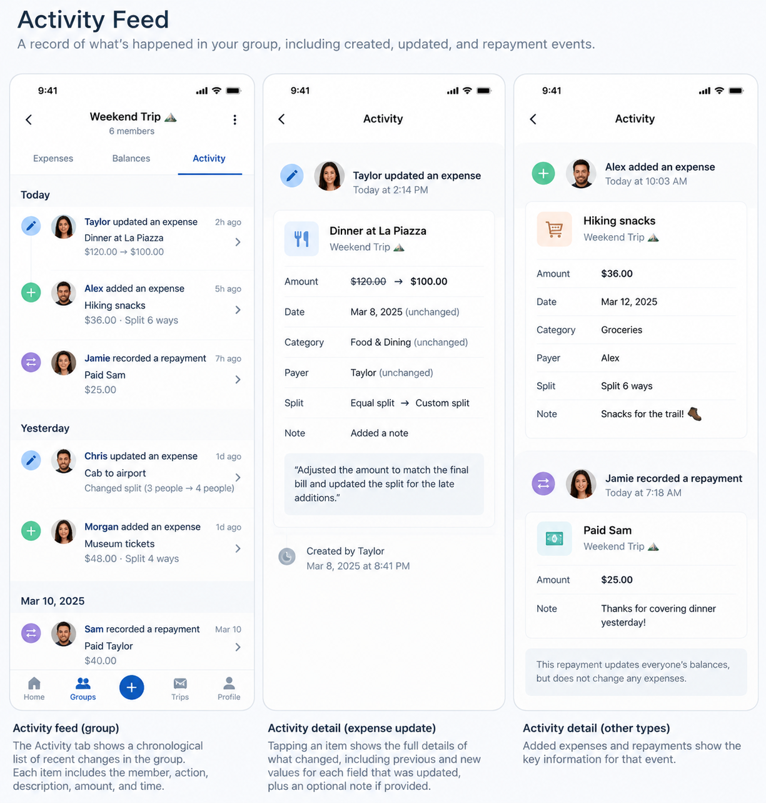

# Expense editing and Activity reference — #212

[Full-size approved Activity board](activity.png)

The 1225 × 1284 PNG is the owner's original attachment, copied without modification.
SHA-256: `aabefd681c1b922e83d6dd1c6e13c4eea5870f61ac2a5cf764e710e3d1a65dae`.

Use the board's chronological sections, actor/action hierarchy, distinct event
icons, source attribution and clearly labeled previous/new values. These are
separate feed/detail states, not three phone frames in the application. Desktop
uses a contextual detail panel; mobile retains a reachable Back action and focus
restoration. These #212 behavioral and historical-detail requirements remain
applicable. Current typography, palette, shared navigation and component roles
follow [#227 and its exact reference](../../issue-227-implementation.md), including
locally bundled Roboto. The earlier [A/B system](../approved-ui/README.md) and
[foundation](../approved-ui/foundation.md) preserve the visual history only.

Names, dates and amounts are illustrative. Use supported categories and EQUAL,
EXACT and PERCENTAGE labels. Do not introduce the board's Home hierarchy, global
plus, settings menu, receipts, deletion or other unsupported controls. #212
supersedes the older reference's prohibition on expense Edit only for its approved
editing flow. Financial event time is separate from expense effective date.

Repayments record actual transfers; this application does not move money. A
repayment changes only sender/recipient positions and never expense spending.
Original creation/update/repayment event details must remain historical facts
following later expense edits; a separately labeled current-expense action may
request a fresh authorized record.

Delivery acceptance requires final-head screenshots at 320, 390, 768 and 1280px,
light/dark themes, 200% text, long content, keyboard/focus and an actual persisted
edit followed by its Activity detail. The image itself is not acceptance evidence.

## Verified implementation

The [captured production components](evidence/README.md) show the real API-backed
edit and all three historical event types beside the approved reference above.
