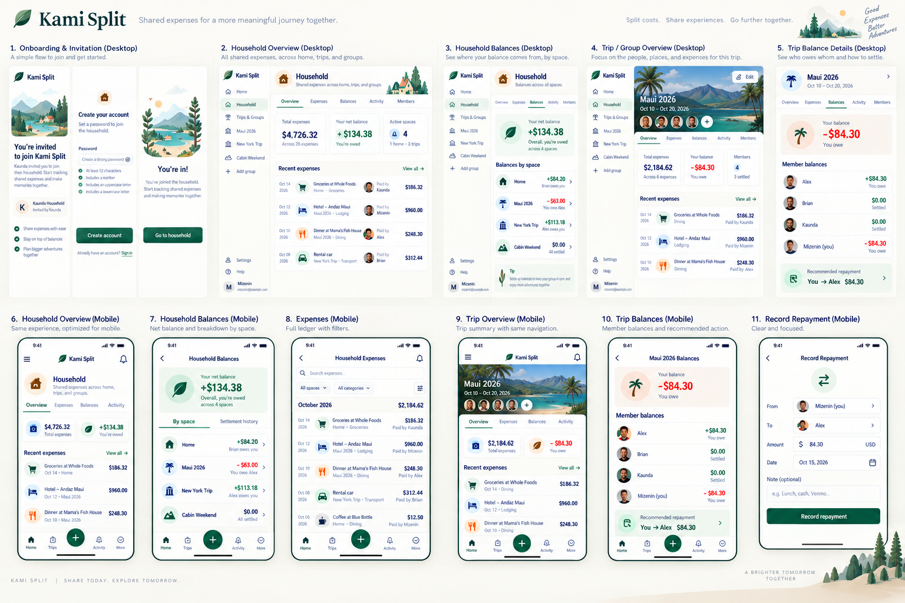
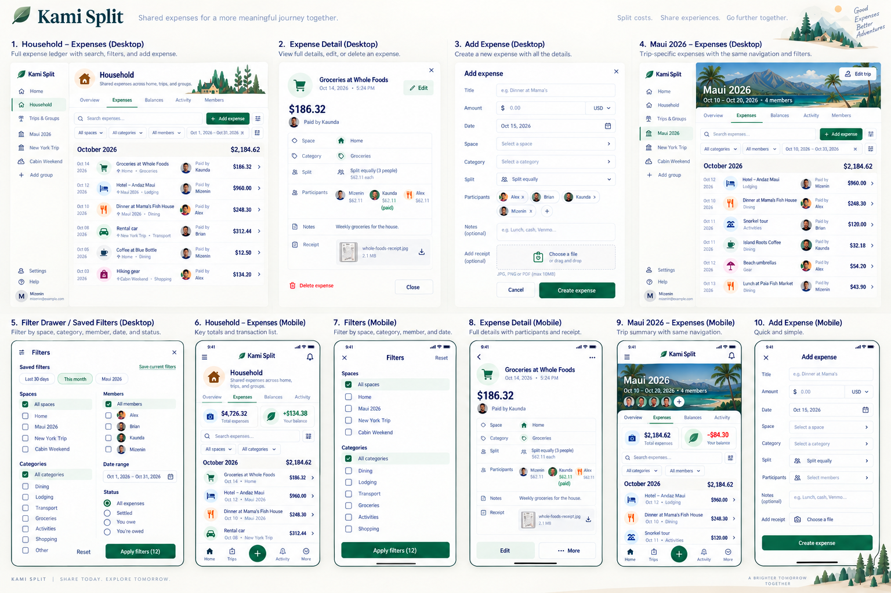

# Approved production visual references — issue #189

The owner supplied and approved these original 1536 × 1024 PNGs for [issue #189](https://github.com/haggaikaunda/kami-split/issues/189). They are the visual acceptance targets, not optional inspiration. Product/API contracts remain authoritative for behavior. These assets are design references, not flattened application backgrounds or production UI.

## Original boards

### Board A — Product experience

[Full-size Board A](kami_split_ui_ux_showcase.png)



### Board B — Expense workflows

[Full-size Board B](kami_split_expense_dashboard_mockup.png)



The originals are byte-for-byte copies of the owner's attachments. Verify with `shasum -a 256 docs/design/references/approved-ui/*.png`:

```text
a910bacafdd64aa969dc66a3fa32b3c74589f8d3baa6a6bcd1ec1375caa5e1f0  kami_split_ui_ux_showcase.png
b607c9832e35ffb737bf71cfd1e010eca0c46317c3daf547d79dc6df98f32afe  kami_split_expense_dashboard_mockup.png
```

## Production inventory and acceptance ledger

Inventory baseline: `19897a1` (post-#184 authenticated runtime). Paths below are relative to `apps/web/src/`. Each row requires baseline and final browser evidence at the exact tested commit before completion; prior closed issues do not establish visual acceptance. No visual implementation or screenshot acceptance is claimed by this reference-publication slice.

| Surface                                                        | Panels             | Production route / component                                                                                                     | Implementation and evidence |
| -------------------------------------------------------------- | ------------------ | -------------------------------------------------------------------------------------------------------------------------------- | --------------------------- |
| Invitation / password / success                                | A1                 | `/join`, `/auth/password`, `/auth/confirm`; `components/onboarding/screens.tsx`, `entry.tsx`                                     | Pending                     |
| Household Overview                                             | A2, A6             | `/household`; `components/groups/household-workspace.tsx`                                                                        | Pending                     |
| Household Balances                                             | A3, A7             | `/household?tab=balances`; same workspace                                                                                        | Pending                     |
| Trip/Group Overview                                            | A4, A9             | `/groups/[groupId]`; `components/groups/workspace.tsx`, `journey.tsx`                                                            | Pending                     |
| Trip/Group Balances                                            | A5, A10            | `/groups/[groupId]?tab=balances`; same workspace                                                                                 | Pending                     |
| Record repayment                                               | A11                | `/groups/[groupId]/repayments/new`; `components/groups/repayment-form.tsx`                                                       | Pending                     |
| Household Expenses                                             | B1, B6             | `/household/expenses`; `components/expenses/household.tsx`, `ledger.tsx`                                                         | Pending                     |
| Trip/Group Expenses                                            | B4, B9             | `/groups/[groupId]?tab=expenses`; `components/expenses/ledger.tsx`                                                               | Pending                     |
| Expense detail                                                 | B2, B8             | Ledger `expense`/`expenseGroup` URL context and `/groups/[groupId]/expenses/[expenseId]`; `components/groups/expense-detail.tsx` | Pending                     |
| Add expense                                                    | B3, B10            | Existing ledger create flow; `components/groups/expense-form.tsx`                                                                | Pending                     |
| Filters                                                        | B5, B7             | Shared ledger URL filters; `components/expenses/ledger.tsx`                                                                      | Pending                     |
| Activity, Members, discovery, dialogs and all non-happy states | Inherit A/B system | `components/activity/feed.tsx`, group/Household workspace, `/groups`, `/trips`, `/account`, `/invitations`                       | Pending                     |

## Implementation rules

Use the existing Manrope/DM Sans delivery, shared primitives and production tokens. Warm off-white canvas, white surfaces, forest/emerald actions, restrained sage/sand/blue accents, fine separators, compact horizontal metrics, tabular money, coherent line icons, leaf identity and aligned avatars establish the hierarchy. Derive and record spacing/type/radius measurements during the foundation slice; retain accessible text and target sizes rather than copying board-scale typography.

Desktop has persistent navigation, workspace identity, five tabs, compact summaries, aligned ledger rows and contextual detail panels. Mobile keeps horizontal summaries at 390px and deliberately adapts at 320px, with reachable actions and safe areas. Keep existing usable dark mode. Local decorative Household/onboarding art and scenic Trip headers are required; ordinary Groups use neutral contextual art. Decorative artwork must have a fallback, avoid layout shift and remain hidden from assistive technology. No upload functionality is implied.

Build shared foundation and demonstrate Household Overview/Expenses before propagating patterns. Use real accessible components and real server data. Never restore seeded providers/routes or expose synthetic visual fixtures as another application. Board captions, panel numbers, external slogans and footer ornaments are not application chrome.

## Explicit semantic corrections

1. Omit search entirely; #177 owns future search. No fake, disabled or client-only substitute.
2. Omit receipts/upload/OCR and unsupported expense Edit/Delete. Preserve create/read contracts.
3. Use authoritative categories and existing space/category/member/date filters. No Shopping/Gear, saved filters or expense-status filters. Fixed Group/Trip scope has no space selector.
4. Household aggregates independent source ledgers. No aggregate repayment, cross-group netting or settle-all. Zero net with open source balances is not settled. Repayment requires explicit group, sender, recipient and amount and does not transfer money.
5. Household metrics are Total shared expenses / Your net balance / Active spaces. Group/Trip metrics are Total expenses / Your balance; members belong in the header/tab. Use complete server totals, never loaded-page sums.
6. Board values, people and dates are illustrative. Render exact supported amounts and all counterparties. Payer status does not mean an allocation is settled. Preserve positive/negative/zero labels and warm-clay owes; destructive red is for errors/destructive actions.
7. Use canonical routes and authorized actions. No dead Help/settings/notification links, unsupported group edit, invented Home hierarchy or silent source selection by global add.
8. Preserve actual password policy, invitation eligibility and all server-owned authentication, account isolation and recovery transitions.

## Required evidence

Capture baseline/final screenshots with panel IDs, route/state, viewport and exact commit using synthetic authorized data. Exercise 320, 390, 768 and 1280px, 200% text, keyboard/focus, dialog trapping/restoration, reduced motion, contrast and safe areas. Cover multi-month pagination, long names/descriptions, large exact amounts, active filters, Back/Forward/scroll restoration, creation/allocation/repayment/recovery, zero-net open balances, multiple obligations, loading/empty/filtered-empty/unavailable/access loss/account switch.

Independent requirements testing and whole-final-diff review must inspect both original boards and rendered screenshots. Passing CI or a component gallery alone does not establish visual acceptance. Track deviations explicitly. Follow the [delivery workflow](../../../agents/delivery-workflow.md); partial PRs reference #189 without closing it.
