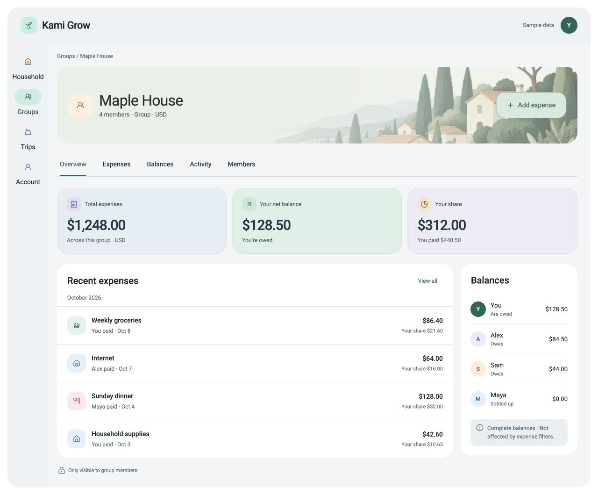
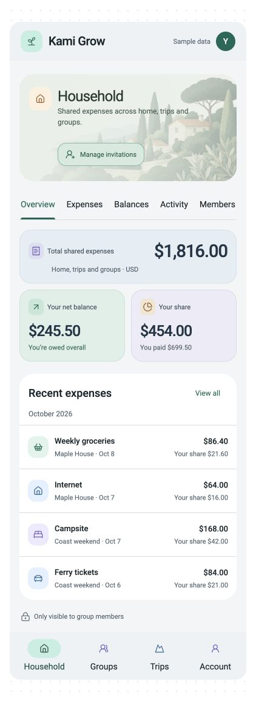

# Approved Material design reference

This owner-approved design reference supports [issue #223](https://github.com/haggaikaunda/kami-split/issues/223). It supplies interactive mockups for the planned Material 3–inspired Tonal overview migration. **This reference does not implement or complete the redesign.**

## Download and use

[Download the reference pack](kami-grow-material-design-reference-2026-10-09.zip) using GitHub's **Download raw file** control, then extract it and read its `README.md`. Open `desktop.html` and `mobile.html` in a current browser. No Codex conversation, application backend, credentials, build or original local path is needed. The files embed banner artwork and load pinned Lucide and Floating UI libraries from public CDNs; full visual fidelity therefore requires network access. Google Fonts is optional with an Arial fallback. Included screenshots remain usable offline.

The pack contains two standalone interactive mockups, two readable source fragments, 12 screenshots, a dated acceptance-criteria snapshot, contrast checks and a SHA-256 manifest. The live issue remains authoritative over its snapshot. The snapshot's original attachment-comment wording is superseded by this checked-in reference pack.

ZIP SHA-256: `26d02893c8bb6333076a772570c8775f9472d99fa95bf1f64ebf69963d0dad62`

Use **Account → Light**, then return to **Household/Groups/Trips → Overview** to inspect the latest light-mode refinement. Explore **Expenses → List/Breakdown**, combined Filters, expense detail/edit, and Account. On desktop, click outside an expense drawer to dismiss it. The mobile export shows a dedicated detail page with Back. The pack's README includes walkthroughs and a screenshot index.

## Approved direction and precedence

- Preserve main navigation order: Household, Groups, Trips, Account.
- Preserve workspace tab order: Overview, Expenses, Balances, Activity, Members.
- Retain Your share as a summary card and add it to Household in place of Active spaces.
- Retain the original illustrated title banners, adapted to both themes and mobile.
- Dark mode keeps strong contrast, white monetary headlines and differentiated category/navigation icons.
- **Light mode uses softer pale blue-grey, mint and lavender summary cards and a pale illustrated banner with readable dark text.** This 2026-10-09 refinement supersedes the earlier screenshot's dark filled cards/banner in Light.
- Desktop Overview has a balances sidebar; mobile omits that list while retaining the Balances tab.
- Desktop expense detail/edit uses a dismissible right drawer; mobile uses a full detail page. Preserve combined filters and add a category Breakdown under Expenses.

The mockups use sample data and simplified interactions. They do not define financial or security policy. Preserve all current production features, including Equal/Exact/Percentage splits, participant controls, source-aware authorization, URL navigation, durable draft/operation recovery, immutable history, guarded profile edits, explicit persisted appearance saves, invitations and real sign-out. The prototype's editable email, immediate local theme change, sample equal split and fake action handlers must not replace current contracts. The representative sprout icon is not a request to replace the existing brand.

Implement through current shared primitives, tokens, Relay/API ownership and verified forms; do not copy the monolithic fragment or reintroduce the retired seeded runtime. See issue #223 for the full parity matrix, aggregate read-model gap, acceptance criteria, implementation slices and verification gates.

## Updated light-mode references

## Provenance and verification limits

Created from the owner's approved Codex mockups on 2026-10-09, using compressed display copies of the repository's existing Household/Trip artwork. All expense/person examples are illustrative; no credentials or real financial data are included.

Baseline inspected: `e7f76f58999a42c12842e70c8ba6b898fd17c6d1`. Clean primary `main` was fetched/pruned and synchronized to that `origin/main` SHA before this reference work.

The reference revision was opened in a browser and checked for light/dark rendering, outside-click dismissal, in-place edit controls, five simultaneous filters, Breakdown totals, mobile detail-page behavior, hidden mobile overview balances and 320px app-width layout. Solid summary-card text/fill pairs exceeded 4.5:1 (minimum tested 5.25:1). This is limited prototype evidence, not a full accessibility audit or production acceptance. Future implementation must satisfy independent testing, final-diff review and all current repository delivery gates.
